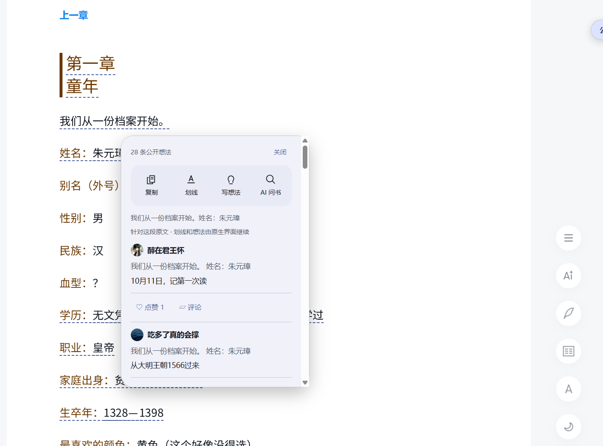
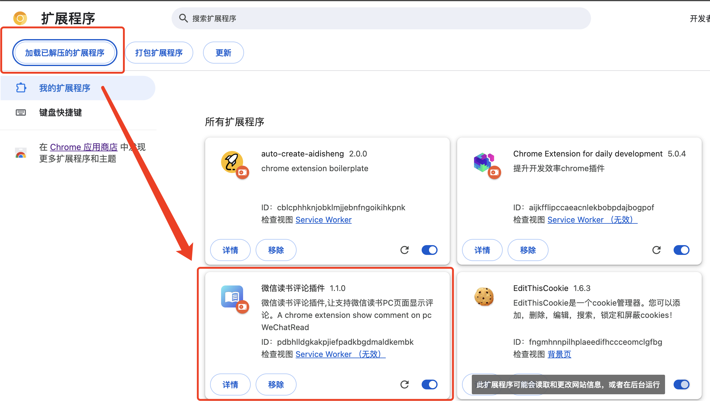

# 微信读书评论增强版

基于原项目 [wx-read-comment-extension](https://github.com/my19940202/wx-read-comment-extension) 开发的非官方增强版本，面向微信读书网页版。本仓库为 [SoiTeoh/wx-read-comment-extension-enhanced](https://github.com/SoiTeoh/wx-read-comment-extension-enhanced)，与原作者发布的扩展相互独立。

当前版本：**v1.6.0**（已集成 U1–U5、动态重合标记与右侧页边聚合展示）。仅增强**上下滚动阅读模式**，左右双栏保持官方界面。详细更新记录见 [CHANGELOG.zh.md](CHANGELOG.zh.md)，开发与演进路线见 [开发规划](docs/development-plan.md)。

## 主要功能

- **公开评论划线与弹窗**：在上下滚动阅读页面绘制可点击的公开评论划线，点击查看对应公开想法；重合原生划线时保留微信读书原生操作，并通过旁边的数字 badge 查看公开评论。
- **可选右侧评论栏**：支持阅读位置高亮联动、点击评论跳到正文、阅读顺序 / 接口顺序 / 点赞最多排序、全文搜索、定位状态筛选、作者筛选，以及舒适 / 紧凑密度切换。
- **原文操作与想法互动**：评论弹窗顶部提供复制、划线、写想法和 AI 问书入口（交由官方工具或编辑器完成）；想法卡片支持点赞 / 取消点赞与官方回复详情入口。
- **长评论与导航体验**：同段想法分批加载（每批 30 条）、长评论折叠与展开、字号/侧栏/回复关闭后尽量恢复阅读位置，并提供可选阅读快捷键（`Alt+Shift+C` 打开附近想法、`Alt+Shift+Y` 复制核实原文、`Esc` 关闭弹窗）。
- **本地收藏与导出**：支持主动收藏公开想法快照，提供搜索、单条删除、清空与完整 Markdown 导出。
- **日夜主题适配**：插件划线、badge、弹窗与侧栏均适配微信读书日间／夜间模式，设置保存在本地存储。

## 效果预览

### 评论浏览与本地收藏（v1.6）

[统一评论弹窗（日间）](docs/previews/u2-popup-day.png) · [夜间](docs/previews/u2-popup-night.png)

[收藏夜间效果](docs/previews/u3-favorites-night.png) · [U1 浏览](docs/u1-comment-browsing.md) · [U2 阅读导航](docs/u2-reading-navigation.md) · [U3 收藏](docs/u3-local-favorites.md) · [U4 排序与筛选](docs/u4-comment-browsing.md)

### 纵向原文操作与想法互动（v1.5）

[夜间效果](docs/previews/i3-vertical-night.png) · [窄窗口效果](docs/previews/i4-vertical-narrow.png)

### 基础划线、重合 Badge 与侧栏

## 安装方式

### 本地开发安装

1. 克隆本仓库，进入项目目录后运行 `npm install`。
2. 运行 `npm run build`（生成 `build/` 目录及 `releases/` 下的安装包）。
3. 在 Chrome 打开 `chrome://extensions`，开启“开发者模式”。
4. 点击“加载已解压的扩展程序”，选择本项目的 `build` 目录。

也可以从本仓库的 [GitHub Releases](https://github.com/SoiTeoh/wx-read-comment-extension-enhanced/releases) 下载增强版 zip，解压后按上述方式加载。更新已有扩展时，替换解压目录文件后在扩展管理页重新加载扩展，再刷新阅读页即可保留设置与本地收藏。

## 使用说明

在微信读书网页版打开书籍并切换到**上下滚动模式**：

- **显示可点击评论划线**：控制插件划线的显示，不改变微信读书原生划线。
- **显示右侧评论栏**：关闭后正文恢复宽度；公开评论划线及点击弹窗仍可使用。
- **跟随阅读位置**：开启后，侧栏高亮靠近当前阅读位置的已映射评论；点击侧栏中可定位的评论可跳转到正文。
- **排序与筛选**：支持按“阅读顺序 / 接口顺序 / 点赞最多”排序，以及按正文、引用、作者和定位状态筛选；切章自动清空临时筛选。

## 已知限制

- 仅展示微信读书接口返回的公开评论／公开想法，不读取、模拟或推测私密评论。
- 部分历史 `range` 可能因正文版本或 Reader layout 不匹配而无法映射；此类评论仍可在侧栏查看，但不能定位到正文。
- “写想法”和“评论”由用户在官方原生编辑器中确认提交；回复最终提交与真实分页仍待发布前本地手工验收。
- 微信读书前端更新可能影响内部 Reader runtime 的兼容性，不兼容时插件会自动安全降级并保留侧栏浏览。

## 开发与验证

- `npm test`：运行 83 项离线单元测试（不依赖登录态或真实接口）。
- `npm run test:acceptance`：运行离线测试、TypeScript 检查、构建及 Playwright 受控浏览器回归。
- 完整路线图与架构整理见 [开发规划](docs/development-plan.md)，各阶段详细验收文档均位于 `docs/` 目录。

## 来源与许可

本项目基于 [原项目 wx-read-comment-extension](https://github.com/my19940202/wx-read-comment-extension) 开发，并非原作者的官方版本。项目沿用 MIT License；原作者版权声明保留在 [LICENSE](LICENSE) 中。

Maintainer: SoiTeoh · <z993851877@gmail.com>
