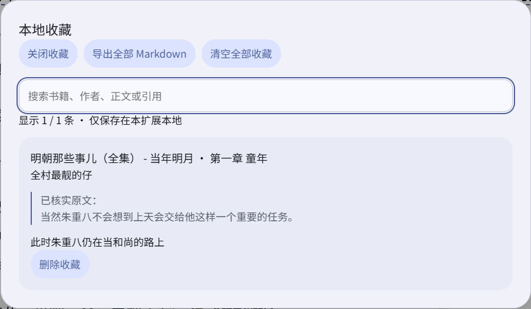
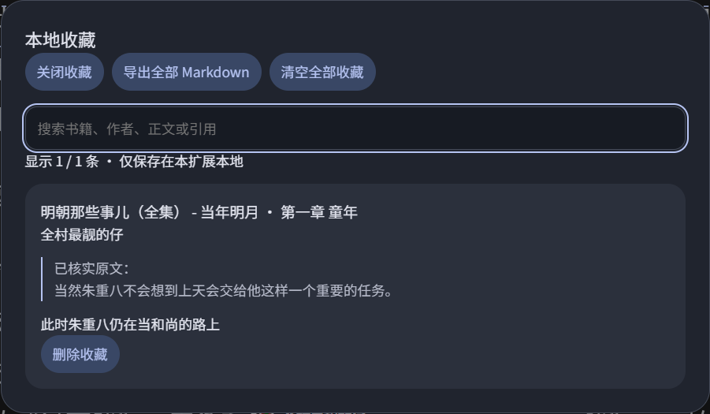

# U3 · 本地收藏与导出

日期：2026-10-13。已完成本地开发与验收，保持现有 Material You 风格。仅增强上下滚动页面，U4–U6 未开始。本轮没有推送、升级版本或发布安装包。

## 成品效果

截图为真实登录态中的一条公开想法临时收藏；验收后已删除这次新增记录，没有清空用户原有收藏。

## 使用与数据范围

- 在侧栏或正文 popup 的想法卡片点击“收藏”，再次点击“已收藏”可取消；两处状态同步。不依赖点赞或原生回复能力，不替用户执行账号写操作。
- 从侧栏或 popup 顶部“本地收藏”打开管理。管理独立于当前章，支持书籍、章节、作者、正文和引用搜索，搜索不连接微信读书接口。
- 保存的是用户点击时的内容快照，包括书籍／章节／想法 ID、公开标题、作者名、纯文本正文、引用来源、公开 Reader 链接和收藏时间。未保存头像、cookies、token、会话或整个接口响应；链接移除查询参数，异常链接不写入。
- 当前 popup 已核实的原文可随收藏保存；否则保存公开想法接口附带的引用，并分别标注来源。没有引用时不以评论正文冒充原文。
- 保存来源为已加载的公开列表，显式私密或身份不符的条目拒绝保存。正文保留纯文本全文、换行与合法实体；验证存储时不再次把普通尖括号文本当成 HTML 删除。
- 管理中的长正文沿用 U1 的折叠与全文展开。导出全部收藏的 Markdown，包含完整正文和引用，搜索过滤不会减少导出内容；导出仅由用户点击触发。
- 可删除单条，清空全部需要再次明确确认，可取消。清空针对全部收藏，不是当前搜索结果。导出内容对 Markdown／HTML 特殊语法转义，不生成可执行页面。
- 数据仅在当前浏览器的 `chrome.storage.local` 中，不跨设备同步、不后台采集，也不自动刷新已保存的快照。没有增加扩展权限或依赖。

## 可靠性

- 后台 service worker 统一串行处理收藏写入，每次从存储重新读取最新数据，避免不同标签页相互覆盖；相同书籍与想法 ID 只保存一条。不会覆盖原有插件设置。
- 用户点击时先捕获书籍和章节上下文，再异步加载本地数据，避免等待期间切章导致归属错误。重复点击有前端保护，写入成功后才更新状态。
- 最多 500 条、集合序列化 UTF-8 不超过 2,000,000 字节；正文和引用分别不超过 60,000 字符，标题和作者分别不超过 1,000 字符。超限拒绝，不静默截断。
- 读取损坏数据、写入失败或容量不足时显示提示，不把失败当成功、不覆盖原库；有上次有效缓存时保留它供浏览与备份。首次读取失败时禁用导出与清空。
- 同版本开发更新后台代码后，需要在 Chrome 扩展管理页重新加载扩展，并刷新阅读页。测试 profile 起初仍在运行旧后台，新收藏消息没有响应；开启专用 profile 的开发者模式并重新加载后恢复。现在对此提供明确的重载提示，数据未被覆盖。
- 管理支持 Tab 焦点循环、Esc 关闭和返回触发入口；切章／切书／退出纵向时只关闭管理 UI，不删除本地收藏。阅读快捷键不会抢占管理中的输入和按钮操作。

## 验收结果

完整 `npm run test:acceptance` 通过：80 项离线测试、TypeScript、开发构建与 76 项 Chromium 场景。新增 9 项离线收藏模型／内容脚本测试，以及 7 项 U3 浏览器场景；最后补充的长正文键盘展开与完整导出亦通过。

覆盖字段白名单、私密／身份／超限拒绝、文本往返、Markdown 转义、并发去重、存储失败、不响应后台、异步上下文、设置保留、侧栏／popup 同步、首次无自动收藏、引用来源、下载文件内容、刷新／切章持久化、损坏存储保留、单条删除、取消与确认清空、窄窗口、日夜、焦点和模式退出。全部网页请求受控，账号写请求为零。日志及测试导出位于忽略的 `.test-artifacts/u3`。

真实本地验收沿用 Windows 桌面 headed Playwright Chromium，在《明朝那些事儿（全集）》纵向页面：

- 本地收藏数量从 0→1，popup 显示已收藏；管理显示公开想法和已核实原文。
- 搜索书名匹配该记录，不存在的关键词显示空结果；日间与夜间界面正常。
- 只删除本次新增记录，数量恢复为 0，没有清空其他记录或改动账号点赞／回复。
- 没有点赞、评论或发布的写请求，没有导出登录凭据。Markdown 下载内容和并发／故障路径由隔离自动化验证，本轮未导出真实个人收藏库。

已交付的 v1.5.0-beta.1 ZIP 保持原始 SHA-256，U3 只在当前开发 build 中，需后续新版本发布才进入安装版。
