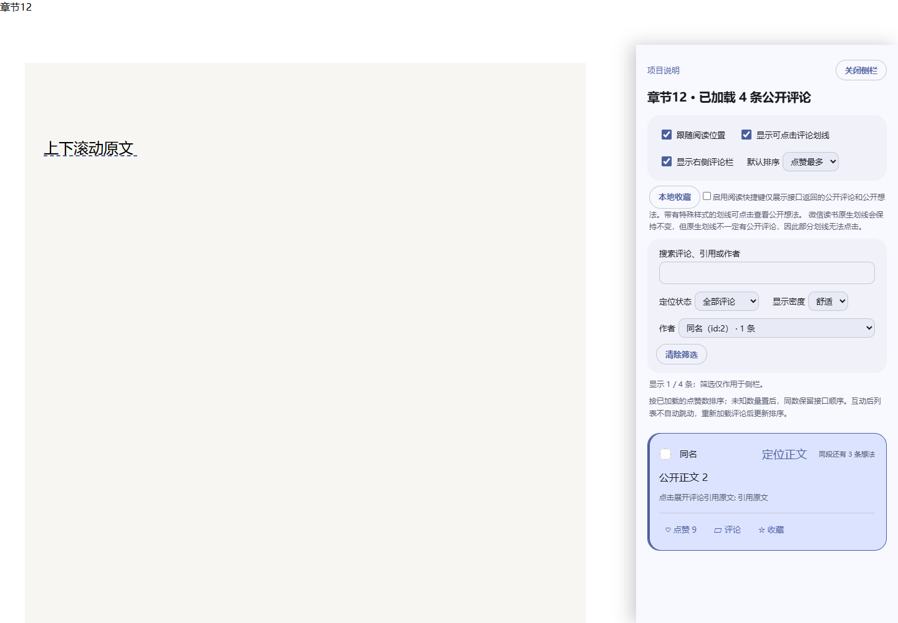

# U4 · 评论浏览增强

日期：2026-10-14。仅增强上下滚动阅读页的插件侧栏，沿用现有配色、圆角与控件；左右双栏保留官方界面。

## 行为

- 默认排序新增“点赞最多”，按已加载的有效点赞数降序。零是有效数量，缺失、负数、非整数作为未知放在末尾；同数量及未知组内保持接口顺序。
- 仅派生侧栏列表，不改变源数据、正文映射、同段计数或完整 popup。互动后的按钮状态继续同步，排序使用加载时快照，不自动移动卡片；重新加载章节评论更新排序依据。
- 作者优先按 userVid／vid／uid 区分，同名不同 ID 显示身份提示；缺少 ID 时按名字归组，完全缺失显示未知作者，无法凭名字区分同名用户。
- 作者选项来自全部已加载评论并显示条数，可与全文搜索、定位状态组合。清除筛选同时重置三个条件。
- 排序沿用本地设置保存；作者筛选不持久化，切章、刷新及退出纵向时清空。没有新增权限、请求或写操作，不读取每条详情补齐点赞数。

## 验收

- 83 项离线测试、TypeScript 与生产构建通过。原有 76 项 Chromium 场景通过，新增 6 项 U4 通过，共 82 项。
- 首轮 U4 测试夹具误用了重复作者 ID、模式切换未更新控件，修正夹具后通过；最终窄窗口样式构建后再次通过 U4。
- 覆盖零／未知／同数、同名作者、组合筛选、完整同段 popup 与计数、持久化、接口顺序恢复、窄窗口、日夜、横向退出、返回纵向与切章清理。
- Windows 桌面可见 Playwright Chromium 的真实登录态纵向《明朝那些事儿（全集）》“第一章 童年”：489 条评论，点赞排序及作者筛选为 2 条，清除恢复 489 条。操作期间评论列表请求增量 0，review POST 0；未点赞、回复或发布。结束恢复阅读顺序。
- 489 是本次观察值，会随网站数据变化。版本保持 1.6.0-beta.1，本地 U4 尚未重新打包或推送；U5、U6 未开始。

## 成品预览

以下使用受控示例内容展示同名作者和日夜样式，不冒充真实书籍数据。

[夜间效果](previews/u4-author-likes-night.png)
